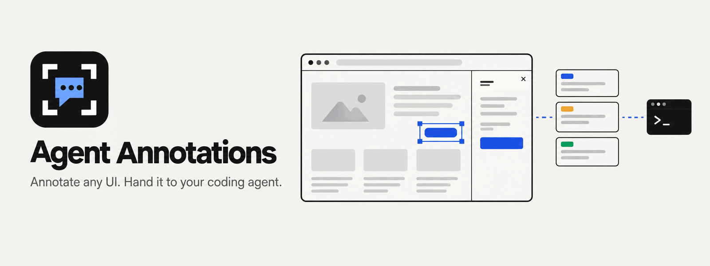
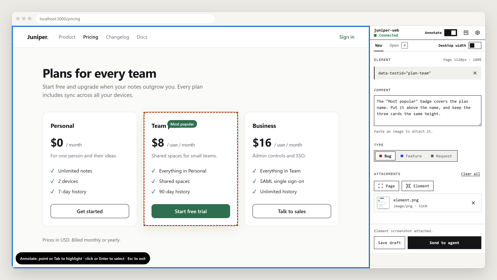
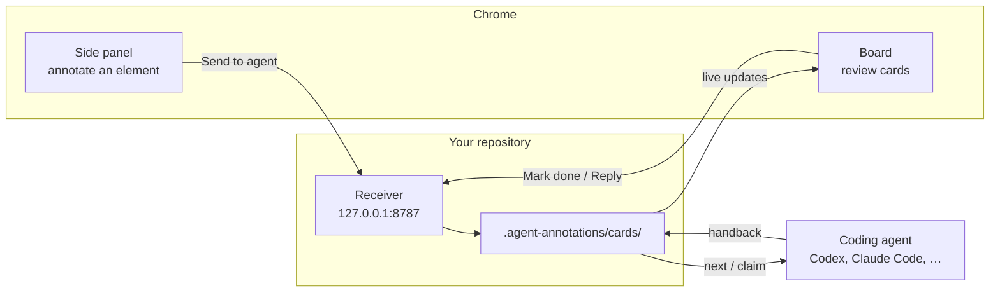
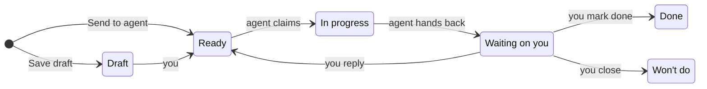
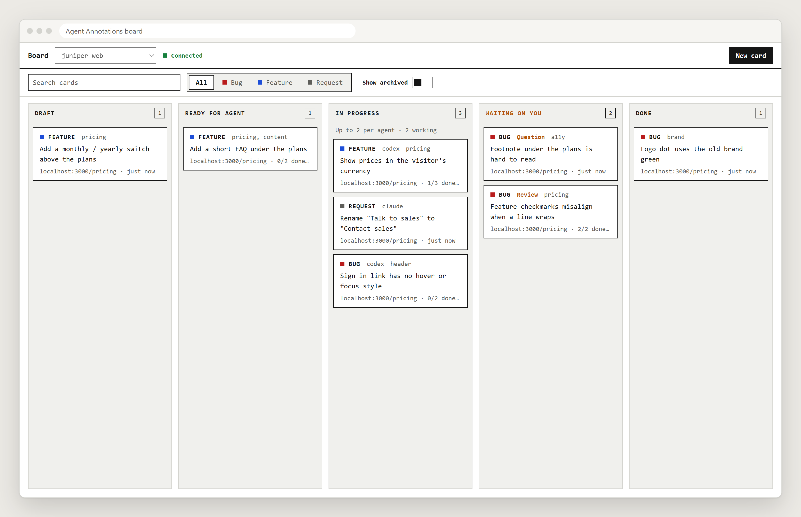
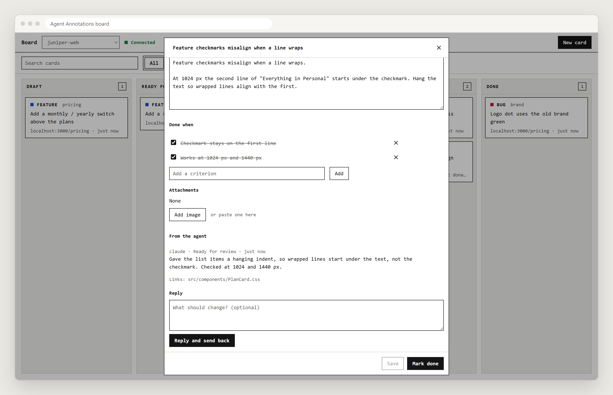
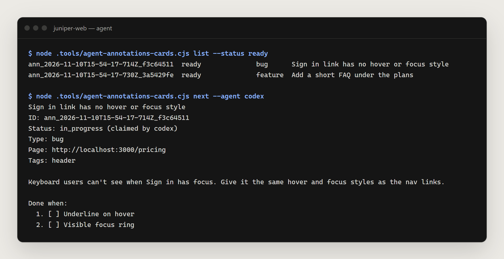

<picture>
  <source media="(prefers-color-scheme: dark)" srcset="docs/images/header-dark.png">
  
</picture>

<p align="center">
  <a href="https://github.com/ossianravn/agent-annotations/releases/latest"></a>
  <a href="https://www.npmjs.com/package/agent-annotations"></a>
  <a href="LICENSE"></a>
</p>

Agent Annotations is a Chrome side panel for pointing at things on a web page
and telling a coding agent what to change. You click an element, write a
comment, and send it. The note lands in your repository as a card with the
page, the element's locators and a screenshot. Codex, Claude Code or another
agent picks it up, does the work and hands it back, and you review the result
on a board.

It works on any page: your local dev server, a staging site or the live site.
Everything stays on your computer; the extension talks only to a small
receiver running in your repo.

<picture>
  <source media="(prefers-color-scheme: dark)" srcset="docs/images/panel-dark.png">
  
</picture>

## Get started

You need Chrome (or Edge, Brave or another Chromium browser, version 116 or
later) and Node.js 18 or later. The steps use `pnpm`; `npx` works the same way.

**1. Install the extension.**
Download `agent-annotations-chrome-extension-v<version>.zip` from the
[latest release](https://github.com/ossianravn/agent-annotations/releases/latest)
and unzip it into a folder of its own. Open `chrome://extensions`, turn on
**Developer mode**, click **Load unpacked** and pick that folder. Pin the
extension so its icon stays in the toolbar.

**2. Connect your repository.**
In a terminal, go to the root of the project you want to work on and run:

```bash
pnpm dlx agent-annotations@latest setup
```

This installs the agent skill and a small receiver into the repo, then starts
the receiver. Leave it running. It prints a token, which is also saved in
`.agent-annotations/token.txt`.

**3. Open your app and the panel.**
Open the page you want to annotate (for example `http://localhost:3000`) and
click the extension icon. The panel asks whether to add the page to your
repo. Paste the token from step 2 and click **Add page**. The panel header
now shows the repo's name and **Connected**.

**4. Annotate something.**
Turn on **Annotate** (or press `Ctrl+Shift+Y`, `Command+Shift+Y` on macOS)
and click an element on the page. Write what should change, pick a type (Bug,
Feature or Request), and optionally attach a screenshot of the element or the
page. Click **Send to agent**. **Save draft** keeps it for yourself until it
is ready.

**5. Ask your agent to do the work.**
In your coding agent, in the same repo, run the skill that `setup` installed:

| Agent | What to type |
| --- | --- |
| Codex | `$check-agent-annotations` |
| Claude Code | `/check-agent-annotations` |
| Gemini CLI, Antigravity, OpenCode, Copilot | "check agent annotations" |

The agent claims the card, makes the change, ticks off the card's checklist and
hands it back for review, or with a question if it is stuck.

**6. Review the result.**
Click the board button in the panel header. Cards the agent handed back are
under **Waiting on you**. Open one to read the agent's summary, then click
**Mark done**, or write a reply and click **Reply and send back**.

The next time you work on the project, start the receiver from the repo root
with:

```bash
pnpm dlx agent-annotations start
```

## How it works



- The **extension** captures the element (selectors, test IDs, text, size and
  position), the page URL, the viewport width and any screenshots, together
  with your comment.
- The **receiver** is a dependency-free Node script in `.tools/`. It listens on
  `127.0.0.1` only and writes each annotation as a card in
  `.agent-annotations/cards/<id>/`.
- The **agent** reads and updates cards through a small command-line tool,
  `.tools/agent-annotations-cards.cjs`, never by talking to the browser.
- The **board** and the panel watch the cards and update by themselves while
  agents work.

The cards in the repository are the shared state. The browser and the agent
never need to run at the same time.

## Cards and the board

Every annotation becomes a card with a status, so it is always clear who acts
next.



| Status | Meaning |
| --- | --- |
| Draft | Saved with **Save draft**. Agents never pick it up. |
| Ready for agent | Waiting for an agent. Agents take Ready cards from the top. |
| In progress | An agent claimed it. Each card goes to one agent, and each agent holds at most two. |
| Waiting on you | The agent handed it back, either finished (**review**) or blocked (**question**). |
| Done / Won't do | You closed it. Done cards can be archived. |

The board shows every card of a project, one column per status:

<picture>
  <source media="(prefers-color-scheme: dark)" srcset="docs/images/board-dark.png">
  
</picture>

- Drag cards between columns, or up and down to set the order agents pick
  Ready cards in. With the keyboard, focus a card and press `Alt` plus an
  arrow key.
- Search, filter by type, and use **New card** for ideas that don't belong to
  a page.
- Each card can have a type, tags and a **Done when** checklist. Agents tick
  items off as they meet them, so you can see what is left before you mark the
  card done.
- Open a card to edit it, answer a question, add images (paste them or use
  **Add image**), archive it, or use **Show on page** to open the page with
  the element outlined.

<picture>
  <source media="(prefers-color-scheme: dark)" srcset="docs/images/card-dark.png">
  
</picture>

The **Open** tab in the side panel lists the current page's unfinished cards,
with the ones waiting on you first. If an agent stops while holding a card,
move the card back to Ready to release it.

## What the agent does

The installed skill tells the agent to work through the cards tool. You can
run the same commands yourself:

<picture>
  <source media="(prefers-color-scheme: dark)" srcset="docs/images/agent-dark.png">
  
</picture>

| Command | What it does |
| --- | --- |
| `list [--status ready\|all\|<status>]` | List cards (unfinished ones by default). |
| `next --agent <name>` | Claim the top Ready card and print it. |
| `claim <id> --agent <name>` | Claim a specific Ready card. |
| `show <id>` | Print one card. |
| `comment <id> "text"` | Add a note to the card. |
| `check <id> <number> [--undo]` | Tick (or untick) a Done when item. |
| `handback <id> --review "summary" [--link <file or URL>]` | Hand the card back as finished. |
| `handback <id> --question "question"` | Hand the card back with a question. |
| `move <id> <status>` | Set a status by hand. |
| `archive <id>` | Hide a finished card. |

Run them as `node .tools/agent-annotations-cards.cjs <command>`. Add `--json`
for machine-readable output. Claims go through a lock file, so several agents
can work in the same repo without taking the same card.

Agents only check their work in a browser when you ask them to, using whatever
browser tools they have.

## More about the panel

### Projects

Each repository is a project, identified by its receiver rather than by the
page's address. That means `localhost:3000`, a staging URL and your live
domain can all belong to the same repo. The first time you open a page that
isn't in a project while a receiver is running, the panel offers **Add page**.
`localhost`, `127.0.0.1` and `[::1]` count as the same host.

If another repo's receiver answers for a page (for example because a different
app now runs on that port), the panel shows **Other repo running** and holds
new annotations in the browser until the right receiver is running, so they
never land in the wrong repo. Manage projects and their pages in the panel's
Settings.

### Saving while the receiver is off

Saving never needs a running receiver. Every annotation is stored in the
browser first and sent to its repo as soon as the receiver answers. The
extension checks every minute and whenever the panel opens. Annotations that
are still waiting show in the Open tab with **Retry** and **Discard**.

### Desktop width

Chrome's side panel makes the page narrower, which can switch a site to its
tablet layout. Turn on **Desktop width** to zoom the page out so it keeps the
width it had without the panel. The zoom is undone when you turn it off or
close the panel. Every annotation records the viewport width and zoom it was
made at.

## Setup options

`setup` installs the integration and starts the receiver. `init` installs it
without starting anything, and `start` starts a receiver that is already
installed.

```bash
pnpm dlx agent-annotations@latest setup [options]
pnpm dlx agent-annotations init [options]
pnpm dlx agent-annotations start [--port 8787]
```

| Option | Values | Default |
| --- | --- | --- |
| `--agent` | `auto`, `codex`, `claude`, `gemini`, `antigravity`, `opencode`, `copilot`, `all` | `auto` (detects agent folders, falls back to `codex`) |
| `--skill` | `repo` (in this repo), `user` (your global skill folder), `none` | `repo` |
| `--receiver` | `repo` (copy the receiver into `.tools/`), `none` | `repo` |
| `--port` | Receiver port | `8787` |
| `--host` | Receiver address; use `0.0.0.0` in a container or VM | `127.0.0.1` |
| `--repo` | Repository root to write `.agent-annotations/` into | detected |
| `--no-start` | Install without starting the receiver (`setup` only) | |
| `--force` | Replace existing integration files (needed to update) | |

Where the skill goes for each agent, with `--skill repo`:

| Agent | Location |
| --- | --- |
| Codex | `.codex/skills/check-agent-annotations/` |
| Claude Code | `.claude/skills/check-agent-annotations/` |
| Gemini CLI | `.gemini/skills/check-agent-annotations/` |
| Antigravity | `.agent/skills/check-agent-annotations/` |
| OpenCode | `.opencode/skills/check-agent-annotations/` |
| Copilot | a section in `.github/copilot-instructions.md` |

### Running the receiver in a container or VM

If the receiver runs inside Docker or a VM and Chrome runs outside it, start
it with `--host 0.0.0.0` and publish the port. The token still protects
everything except the health check.

```bash
pnpm dlx agent-annotations start --host 0.0.0.0
```

### Receiver only

To run just the receiver, without installing a skill:

```bash
pnpm dlx agent-annotations-receiver --port 8787
```

The receiver's HTTP API is described in
[packages/agent-annotations-receiver/README.md](packages/agent-annotations-receiver/README.md).

## Updating

Update the extension and every connected repo together.

1. Download the new zip from the
   [latest release](https://github.com/ossianravn/agent-annotations/releases/latest),
   unzip it over your extension folder, and click the reload button on the
   extension's card in `chrome://extensions`.
2. In each repo, stop the receiver (`Ctrl+C`) and run:

   ```bash
   pnpm dlx agent-annotations@latest setup --force
   ```

`setup` without `--force` keeps the files that are already installed, so it
would start the old receiver again. If you have edited the installed skill or
instructions and want to keep them, add `--skill none`.

## Where your data goes

Each card is a folder in your repository:

```text
.agent-annotations/
  config.json          project ID and name, receiver URL, agent limit
  token.txt            the receiver token
  cards/
    ann_…/
      card.md          JSON front matter, then your comment as Markdown
      assets/          screenshots
```

Finished cards stay where they are with status `done`. To change how the
project's name appears in the extension, edit `name` in `config.json`.

`setup` also writes `.gitignore.snippet`. Copy its lines into your
`.gitignore`: it always ignores the token, and you can choose whether
screenshots and cards are committed.

Upgrading from 0.4: on its first start the receiver moves `inbox.jsonl` and
`inbox-resolved.jsonl` into card folders and keeps the old files as
`*.migrated`.

## Troubleshooting

**The panel says Offline.**
The receiver isn't running, or runs on another port. Start it from the repo
root with `pnpm dlx agent-annotations start`, then reopen the panel. A custom
port goes in the panel's Settings.

**The panel says Other repo running.**
A different repo's receiver is on the port this page's project uses. Start the
right receiver, or move the page to the running repo from the prompt.

**Port 8787 is already in use.**
Another receiver is running, often for a different repo. Stop it, or start
this one with `--port <port>` and set the same URL in the panel's Settings.

**The agent doesn't know the skill.**
Run `setup` again with `--agent <your agent>`, or ask the agent to run
`node .tools/agent-annotations-cards.cjs help` and follow it.

## Development

| Path | Contents |
| --- | --- |
| `chrome-extension/` | The side panel, board, content script and service worker (plain MV3 JavaScript). |
| `packages/agent-annotations/` | The `agent-annotations` CLI: `setup`, `init`, `start`, `cards`. |
| `packages/agent-annotations-receiver/` | The receiver, card store and cards CLI. These files are the originals. |
| `repo-integration/` | Templates copied into repos: `.tools/`, skills and instruction snippets. |
| `tests/` | Unit tests and real-Chrome journeys. |
| `scripts/` | Packaging, receiver sync and the README screenshots. |

To try local changes, load `chrome-extension/` unpacked and run the receiver
from this checkout:

```bash
node packages/agent-annotations-receiver/bin/agent-annotations-receiver.js --repo <path-to-a-repo> --port 8787
```

Useful commands:

```bash
pnpm test:extension            # extension unit tests
pnpm test:receiver             # receiver and card store tests
pnpm test:extension:browser    # end-to-end journeys in headless Chrome
pnpm sync:receiver             # copy the receiver into the templates after editing it
pnpm screenshots:readme        # regenerate the screenshots in this README
pnpm package:extension         # build dist/agent-annotations-chrome-extension-v<version>.zip
```

The browser journeys and the screenshot script use Chrome for Testing from
`~/.agent-browser/browsers` if it is installed, otherwise your installed
Chrome. Set `CHROME_PATH` to use another build.

### Releasing

1. Set the same version in `chrome-extension/manifest.json`,
   `packages/agent-annotations/package.json` and
   `packages/agent-annotations-receiver/package.json`, and commit it as
   "Bump version to X.Y.Z".
2. Tag and push:

   ```bash
   git tag -a vX.Y.Z -m "vX.Y.Z"
   git push origin main vX.Y.Z
   ```

GitHub Actions then attaches the extension zip to a GitHub release and
publishes both npm packages through npm Trusted Publishers.

## License

[MIT](LICENSE)
